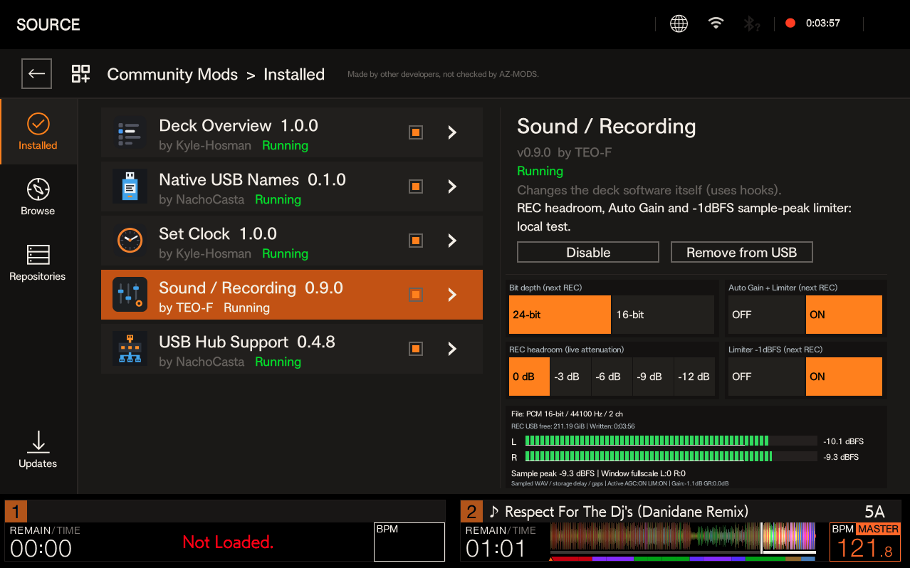
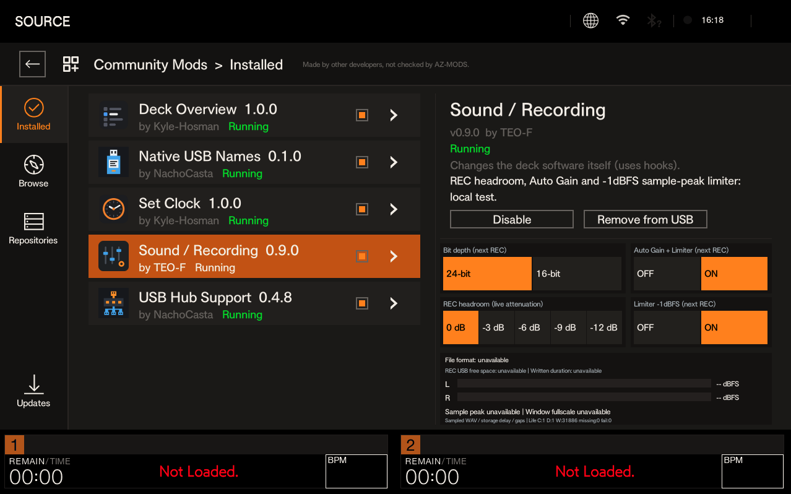

# Sound / Recording

**By Teo-F · Public beta 0.9.2**


An independent AZ-MODS Community Mod for XDJ-AZ. Record **16-bit or 24-bit stereo PCM WAV at 44.1 kHz**, select REC headroom, and optionally use Auto Gain and a stereo-linked sample-peak limiter. Settings and file-derived meters appear inside **Community Mods → Installed → Sound / Recording**.

0.9.2 distributes the **same executable tested as 0.9.0**; publication metadata, author capitalization, documentation and catalog information have changed. It is a public beta tested on one XDJ-AZ, not a claim that every recording or failure scenario has been validated.



Real device captures from the 0.9.0 test build. In this image, **24-bit is selected for the next REC while the active file remains 16-bit**. Changing the preference does not rewrite an open recording.



## Install or update

1. In AZ-MODS Community Mods → Repositories, add `Teo-F/teof-sound-rec`.
2. Refresh Browse, open **Sound / Recording**, and install/update it on a test USB with a backup.
3. On the deck, enable Community Mods and Sound / Recording. Approve the build if requested.
4. Stop and finalize recording and stop playback before using **MOD MENU → Reload**. If approval requires another Reload, complete it.
5. Confirm **0.9.2 · Running**. Open its Installed page to change settings. Start/stop REC normally on the deck.

The catalog requires **AZ-MODS core 1.2.3 or newer** and the exact firmware tag **`ep147-9e9454e357389ece`**. The application was observed as 1.2.7, but that display is not the loader core-version gate. The tested 0.9.0 package used min_core 1.2.3; 0.9.1 incorrectly raised it to 1.2.7 and was refused on the user’s deck. 0.9.2 restores the tested gate. Runtime API-presence checks and exact firmware guards are unchanged. A firmware update can make the mod refuse to load; do not bypass its version/address guards.

## Controls

| Control | Behavior |
|---|---|
| Bit depth | 16-bit / 24-bit, applied to the **next recording**. Fresh install defaults to 16-bit. |
| REC headroom | 0, −3, −6, −9 or −12 dB attenuation. Fresh install defaults to 0 dB. **Live**, sampled at the next recorder-worker call. Select before REC for a clean change; this beta has no gain ramp for manual headroom changes. |
| Auto Gain + Limiter | Off by default. Applies to the **next REC**. Turning Auto Gain On also selects Limiter On. |
| Limiter | Off by default. Applies to the **next REC**. Turning it Off also turns Auto Gain Off. |

Preferences are saved, so upgrades retain existing choices. Active processing is frozen for the take even if the next-REC buttons are changed. Processing state resets on new worker construction and is retired on destruction. Writer changes within that worker retain state in the local adapter; native automatic file splitting has not been tested.

Auto Gain targets **−18 dBFS RMS**, estimates power over about 400 ms, limits correction to **−18…+6 dB**, and adapts at up to about **3 dB/s down / 0.5 dB/s up**. It is not LUFS normalization. Silence freezes gain increases. Detection is before the selected headroom, so −6 dB headroom also lowers the resulting RMS target by 6 dB.

The limiter uses linked L/R gain with a **−1 dBFS sample-peak ceiling**, instantaneous attack and about 100 ms release. It has no lookahead and is **not a true-peak limiter**. Peaks may be reshaped. At 16-bit, final integer quantization can put an encoded peak less than one PCM step above the exact numerical −1 dBFS threshold.

These controls process the recorder's private copied audio planes before native integer packing. They are not MASTER controls or MASTER overload protection, and cannot repair clipping already present upstream. Independent MASTER-output isolation measurements have not been made.

## What the meters show

- Format, written duration and free space are read from the observed recording file and its volume.
- L/R bars show **sampled written-WAV peaks**, with RMS underlines. They have storage delay and gaps between windows; they are not continuous clipping or true-peak detection.
- `Active AGC / LIM`, Gain and GR are copied processing telemetry. GR is the last processed-sample gain reduction, not a whole-take maximum.
- No open file means unavailable. A silent WAV can show `−inf dBFS` and empty bars; this does not by itself indicate a fault.
- Window full-scale counts apply only to the sampled window, not the whole recording. The small Life diagnostic is a local lifecycle counter, not a general device health score.

## Device validation

Measurements below were made on completed WAV copies on 31 October 2026; no music or vendor firmware is distributed. See [testing details and limitations](docs/TESTING.md).

| Test | Measured result |
|---|---|
| Headroom −6 dB, 1 kHz tone | Written-PCM RMS difference **−6.00 dB L/R** versus 0 dB. Other presets have host coefficient tests, not equivalent hardware measurements. |
| Limiter, 24-bit music | Entire 2:08.75 WAV peaked at **−1.00 dBFS L/R**, with no sample above −1 dBFS. Active GR was observed. |
| Auto Gain, steady tone | Gradual increase to **−18.00 dBFS RMS L/R**, about 0.5 dB/s. |
| Low/high/silence sequence | About 0.49 dB/s up and 2.99 dB/s down; high sections settled at −18.00 RMS; approximately +6 dB gain bound and silence hold were supported by the measurements. |
| Longer recording | **34:52** finalized 24-bit WAV, including a user-confirmed **7:30 pause between tracks**; about 27 minutes outside the long silence intervals. No malfunction reported. Sample peaks stayed at −1 dBFS. |
| 16-bit | 1:55.44 WAV with consistent RIFF/data lengths and no full-scale samples. Two right-channel samples were less than one PCM step above the exact −1 dBFS threshold. |
| Normal Disable / Reload / restore | Own module and hooks absent after Reload; stock 16-bit recorder finalized a new WAV; normal Enable/Reload restored the mod. |

**Unverified on hardware:** automatic splits, storage-full/disconnect errors, power-loss or crashing-hook recovery, every headroom preset, long continuous-music and repeated multi-hour operation, true-peak behavior, worst-case timing and every playback configuration. There is no native 48/96 kHz, 32-bit, codec expansion, bit-perfect source or audible-improvement claim. A hook failure can interrupt audio; keep backups and validate your recordings before relying on the beta for a performance.

## Disable / restore

Stop/finalize REC and stop playback. Use **Community Mods → Installed → Sound / Recording → Disable**, then **MOD MENU → Reload**. Selecting 16-bit or turning processing Off alone does not remove the hooks. Enable and Reload normally to restore it; respect any approval prompt.

For a UI that cannot start, use the loader-supported USB disable route: shut down normally where possible, connect that USB to a computer and back up MODS. Set only `community-mods.teof-sound-rec = off` in `MODS/azmods.cfg`, create an empty `MODS/community-mods/teof-sound-rec/teof-sound-rec.off`, and return the USB to the normal boot flow. Confirm Disabled and a fresh stock recording. This is a recovery route, not a claim that a crash/power-loss scenario was tested. Do not erase unrelated settings or bypass approval/quarantine.

## Source and build

Active 0.9.x code is under **`src/`**, host tests under **`tests/`**. Older root-level C/assembly/test files are legacy pre-0.9 sources and are not built by the current Makefile. Obtain the public [AZ-MODS SDK](https://github.com/Kyle-Hosman/az-mods-sdk) separately; it is not vendored here.

```sh
make all SDK_INCLUDE=/path/to/az-mods-sdk/include OUT=/absolute/build/path \
  CC=aarch64-unknown-linux-gnu-gcc CXX=aarch64-unknown-linux-gnu-g++ \
  NM=aarch64-unknown-linux-gnu-nm
make test SDK_INCLUDE=/path/to/az-mods-sdk/include OUT=/absolute/host-build \
  HOST_CC=clang HOST_CXX=clang++
make package SDK_INCLUDE=/path/to/az-mods-sdk/include OUT=/absolute/build/path \
  CC=aarch64-unknown-linux-gnu-gcc CXX=aarch64-unknown-linux-gnu-g++ \
  NM=aarch64-unknown-linux-gnu-nm
```

Production build: C11/C++17, Linux AArch64, GCC 15.2 cross toolchain, only `az_mod_v1_entry` exported, GLIBC 2.17 baseline. The public source/Makefile was rebuilt and produced the exact SHA256 of the device-tested executable:

`8d68dd5b26c72d660639b9e0a6c0fe793b12bbafa9bcda992701a08bd44e32d1`

[Package checksums](downloads/checksums-0.9.2.json) · [Changelog](CHANGELOG.md).

Only original mod code/artwork, tests, license, build outputs and the owner's supplied UI captures are distributed. No proprietary binaries, manuals, music, device dumps, private keys or configuration are included. Not affiliated with AlphaTheta, Pioneer DJ or the AZ-MODS maintainer. **GPL-3.0-only**.
